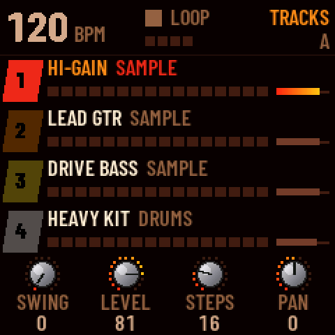
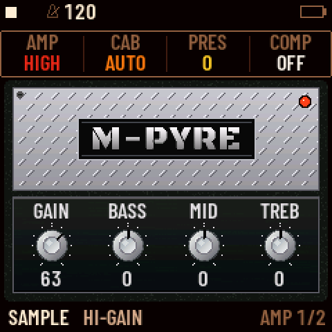
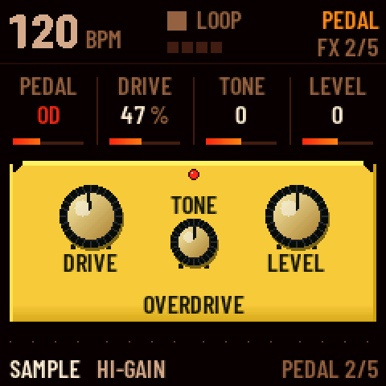
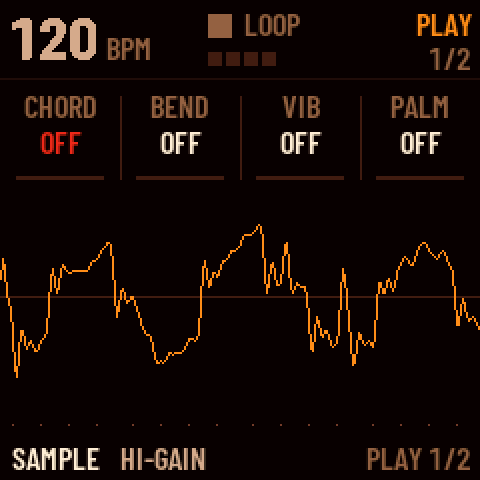
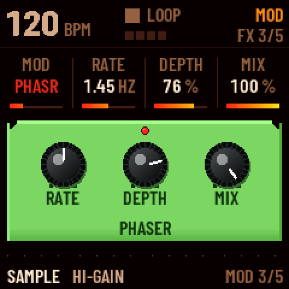
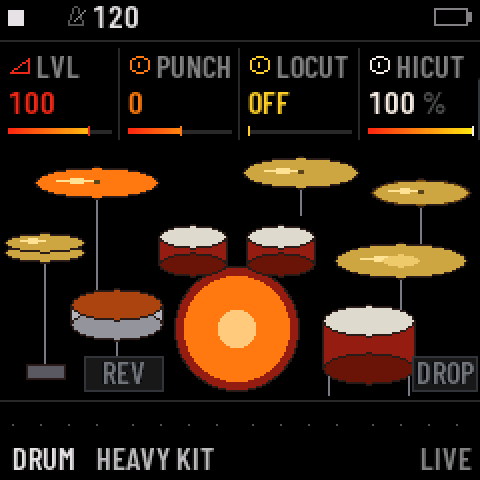

<b>A riffbox firmware for the M-VAVE FM-1 — for rock and metal.</b> 
Made by History Of Sky. Free and open source (GPL-3.0), based on <a href="https://github.com/isod89/sloop-fm1">SLOOP</a>
and <a href="https://github.com/hugelton/Felucca">Felucca</a>.

<a href="https://historyofsky.github.io/m-pyre/"><b>Install from the browser</b></a> ·
<a href="MANUAL.md">Manual</a> ·
<a href="CHANGELOG.md">What's new</a> ·
<a href="../../releases">Releases</a> ·
<a href="../../issues">Report a bug</a>

---

M-PYRE turns the FM-1 into a box for writing riffs. Three tracks play real guitar and bass samples through amp
models and the band's own cabinet IRs, the fourth plays a drum kit the band recorded. The effects are a pedalboard
on the screen. The step sequencer knows palm mutes, slides, accents and power chords. Write a riff, loop it, play
over it.

> **Status:** 1.0. Custom firmware: install it at your own risk. Your FM-1 can go back to the official firmware at
> any time (see [Going back](#going-back)).

## Screenshots

## Features

- **Guitar and bass, sampled:** History Of Sky's DI guitar, palm mutes and picked bass, tuned and looped. Presets:
  CLEAN GTR, CRUNCH GTR, HI-GAIN, DJENT GTR, LEAD GTR, PALM MUTE, DI GUITAR, PICK BASS, DRIVE BASS, HEAVY BASS.
- **Five amps** drawn on the screen (CLEAN, CRNCH, HIGH, LEAD, BASS) with GAIN, BASS, MID, TREB, presence and a
  compressor, through the band's own cabinet IRs. Rhythm guitars are doubled left and right.
- **A pedalboard:** BOOST, OD, DIST, FUZZ and an octave pedal; PHASER, FLANGER, CHORUS, TREMOLO; a delay; a reverb
  with ROOM, HALL, PLATE, SPRING and CLOUD. Wah, whammy and a volume pedal on every guitar and bass track.
- **HEAVY KIT:** a drum kit recorded by the band, with a hi-hat pedal, ride bell, three toms, two crashes and a china,
  plus the synthesised kits 808, 909, 606, 80S, VINTAGE, TRAP and INDUSTR. Each sound has its own level, punch,
  pitch and decay.
- **Played like a guitar:** power chords (PW, PW+, OCT, TERZ), bend, vibrato, palm mutes, legato, whammy and wah on
  the LIVE view; palm mutes, slides and hammer-ons per step in the sequencer.
- **Synths for rock:** MOOG FUZZ, MOOG BASS, MOOG LEAD and the rest of the HYBRID voice, organs, pianos, pads and
  leads (ANALOG, DIGITAL, PHASE, LOFI, TRIO, DRAWBAR, FM6).
- **Everything SLOOP does:** the step sequencer with parameter locks and micro timing, song mode with sections A–D,
  punch-in effects, MIDI in and out, MIDI clock, USB audio, the web editor.

## Install

1. Open **[the M-PYRE installer](https://historyofsky.github.io/m-pyre/)** in **Chrome or Edge** on a computer.
2. Connect the FM-1 by USB: a **data** cable, directly (no hub).
3. Press **INSTALL M-PYRE**, allow MIDI access and wait for *Done*. The FM-1 restarts on the M-PYRE logo.
4. Open the **editor** from the installer page, press **Connect**, go to **samples**, press **Install sound pack** and
   choose
   `soundpack.bin` from the [release](../../releases). This writes the guitars, palm mutes and bass into the FM-1's
   four sample slots; it takes about a minute and is needed once. The drums are in the firmware.

**Before you install:** M-PYRE does not open projects saved by SLOOP 2.6 to 2.8, and the sound pack uses all four
user sample slots (USR1 to USR4). If you have music or samples on the FM-1 you want to keep, save a backup with your
current editor first.

### Other ways

- **Python:** `python3 tools/fm1_install.py m-pyre-1.0.fwsc` (needs `pip install mido python-rtmidi`).
- **Build it yourself:** see [BUILDING.md](BUILDING.md).

### Going back

To return to the official firmware, use M-VAVE's own updater, **M-UPGRADE** (m-vave.com → Downloads → PC Software),
with the official firmware (PC Firmware → FM-1 V15). If it does not find the FM-1, close every other app and browser
tab that uses MIDI.

### Rescue

- **The FM-1 no longer starts M-PYRE:** hold **OCT−** alone while switching it on (*M-PYRE USB RESCUE*), then install
  again.
- **An install was cut off:** the FM-1 stays in update mode; press INSTALL again and it finishes.
- If an FM-1 no longer starts at all, recovery needs
  [FM-1-transporter](https://github.com/kurogedelic/FM-1-transporter).

## Your first riff

1. Switch the FM-1 on. Track 1 is a rhythm guitar (HI-GAIN), track 2 the lead, track 3 the bass, track 4 the drums.
2. Press **ALGORITHM** to pick a track and **PRESETS** to change its sound.
3. On track 4, press **REC** and play a beat on the keys. Press **REC** again on the "1" after your last bar: the
   loop closes, its length sets the tempo, and it plays.
4. Go to track 1, press **REC** and play a riff over it.
5. Tap **SEQ** for the NOTES page: **KNOB 1** picks a note, **KNOB 4** (FORCE) set to **PALM** palm-mutes it.
6. Tap **HOME** for the LIVE view and play over the loop: chords, bend, vibrato and palm mutes are on the four knobs.

The [manual](MANUAL.md) explains the amp view, the pedals, the LIVE view and the drum editor.

## Compatibility

| | |
| --- | --- |
| Device | M-VAVE FM-1 (the official firmware can be put back at any time) |
| Installer and editor | **Chrome or Edge** on Windows, macOS or Linux (Web MIDI with SysEx) |
| Cable | a USB **data** cable, plugged directly (no hub) |
| USB audio | any computer that takes a class-compliant USB audio input (no driver) |
| On a computer | the FM-1 shows up as **M-PYRE** (MIDI and audio) |

## Documentation

- [MANUAL.md](MANUAL.md): how to use M-PYRE
- [CHANGELOG.md](CHANGELOG.md): what changed from SLOOP 2.8.1
- [BUILDING.md](BUILDING.md): build the firmware, run the tests
- [LICENSING.md](LICENSING.md): licences and credits
- [reference/sloop/](reference/sloop/): SLOOP's own manual and guide. The sequencer, song mode, MIDI, USB audio and
  the menu work as described there.

## Credits

- **M-PYRE:** History Of Sky (samples, cabinet IRs, artwork, sound design), with Claude (Anthropic) on the code.
- **[SLOOP](https://github.com/isod89/sloop-fm1)** by **isod89**: the groovebox M-PYRE is built on, with its
  contributors (see [reference/sloop/README-SLOOP.md](reference/sloop/README-SLOOP.md#credits-and-thanks)).
- **[Felucca](https://github.com/hugelton/Felucca)** by **Leo Kuroshita** (@kurogedelic) / **Hügelton Instruments**:
  the engines, the sequencer, the editor and the installer SLOOP is built on.
- **Clipper** by **3dSam**: the HYBRID voice (GPL-3.0).
- Piano, vibes and strings: Versilian Studios VSCO-2 CE and VCSL (CC0). Fonts: Barlow Condensed on the FM-1,
  Terminus in the editor, and Black Ops One, Damion, Pacifico, Racing Sans One and Russo One for the amp names (all
  SIL OFL 1.1). Icons: Fukiai (MIT, Hügelton Instruments). PHASE after CrispyZebra (GPL); FM6: msfa from Dexed
  (Apache-2.0).

## Licence

Code: GPL-3.0-only (see [LICENSE](LICENSE), and [LICENSING.md](LICENSING.md) for the samples and other assets). No
warranty. M-VAVE and FM-1 are trademarks of their owners; M-PYRE is not affiliated with M-VAVE.
